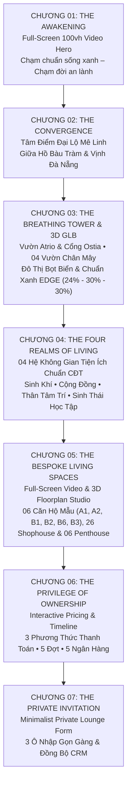

# MASTER PLAN: ĐẬP BỎ & TÁI KIẾN TẠO TOÀN DIỆN LANDING PAGE ECOLIFE SIGNATURE
**Định hướng:** *Quiet Luxury • Giao Diện Sáng Tối Giản (Bright Minimalist) • Ít Chữ • Full-Screen Scroll-Telling • 01 Câu Chuyện – 01 Hành Trình Sống*

> [!IMPORTANT]
> **Mục tiêu cốt lõi dành cho Đội Dev:**
> 1. **ĐẬP BỎ 100% giao diện Landing Page cũ** (bố cục 14 section rời rạc, đóng khung card nhiều chữ, Hero 2 cột kiểu cũ, bảng biểu dày đặc).
> 2. **Xây dựng lại hoàn toàn từ đầu** một trải nghiệm **Web Storytelling Full-Screen (`100vw × 100vh`) trên nền sáng cao cấp**, dẫn dắt khách hàng đi qua **07 Chương Hành Trình Sống** liền mạch.
> 3. **Khai thác triệt để Kho Tài Nguyên Gốc 4K/3D/Video thực tế** nằm tại thư mục nguồn:
>    `d:\Downloads\SOURCE VIDEO KHỚP ẢNH-20261026T070316Z-1-001\` (và `D:\Downloads\STORYTELLING_GENERATED_IMAGES_ECOLIFE\`) — bao gồm **File 3D `.glb` tòa nhà**, **85+ Video chuyển động nội thất từng căn A1, A2, B1, B2, B6, B3**, **Mặt bằng bóc tách 3D góc**, và **12+ Video tiện ích thực tế của 04 Hệ Không Gian**.

---

## PHẦN 1. CHẨN ĐOÁN LỖI BẢN CŨ & NHỮNG GÌ PHẢI ĐẬP BỎ NGAY

| Hạng mục lỗi trên bản cũ | Nguyên nhân thất bại về UX/UI | Yêu cầu bắt buộc ở bản làm mới |
| :--- | :--- | :--- |
| **1. Hero Section nhạt nhòa, thiếu cảm xúc** | Chia 2 cột truyền thống (trái là đoạn chữ dài + phải là khung YouTube nhỏ), không tạo được hiệu ứng thị giác choáng ngợp của một dự án biểu tượng. | **Full-Viewport Video Hero (`100vw × 100vh`)**: Video 4K tràn viền lấy từ kho `INTRO_FAST_TRAILER_15S.mp4` & `MAT_DUNG_10S_VIDEOS`, chữ cực gọn, cuộn nhẹ mở màn như phim điện ảnh (Apple / Aman Resorts style). |
| **2. Sai hình ảnh/video tại "Tâm Điểm Đại Lộ Mê Linh"** | Gắn nhầm video hiệu ứng gió thay vì cảnh thực tế Đại lộ Mê Linh – Hồ Bàu Tràm – Vịnh Đà Nẵng. | Sử dụng đúng bộ video/ảnh vị trí chiến lược: `MD_08_Tong_The_01_Daylight_Aerial_10s.mp4`, `DN_14_Ho_Bau_Tram_Tay_Bac_Da_Nang_Flycam_10s.mp4`, `01_ToanCanh_3Toa_HoBauTram_ChuanMau.jpg`. |
| **3. Quá nhiều chữ & đóng hộp vụn vặt (Box-in-Box)** | Mỗi section nhồi nhét đoạn văn 4–5 dòng, 3–4 tầng thẻ card lồng nhau, bullet list lặp lại thông tin làm rối mắt và mất chất sang trọng. | **Quy tắc Micro-Copy**: Mỗi màn hình chỉ có **1 Tiêu đề + 1 Câu dẫn ≤ 20 từ + 3 Con số lớn**. Mọi chi tiết phụ đưa vào tương tác chạm/lướt. |
| **4. Thiếu phân tách 04 Hệ Không Gian Tiện Ích chuẩn CĐT** | Gộp chung tiện ích hoặc chỉ chia 3 nhóm, thiếu mảng **Sinh Thái Học Tập \| Eco-Edu**. | Trình bày rõ **04 Hệ Không Gian Tiện Ích**: `SINH KHÍ \| VITALITY HUB` • `CỘNG ĐỒNG \| COMMUNITY` • `THÂN TÂM TRÍ \| MINDFULNESS` • `SINH THÁI HỌC TẬP \| ECO-EDU`. |
| **5. Khu vực Căn hộ mẫu chỉ dùng ảnh tĩnh nhỏ** | Ảnh căn hộ bị ép nhỏ trong cột 50%, không tận dụng được kho **85+ video chuyển động nội thất** và **Mặt bằng 3D góc** của từng căn. | **Full-Bleed Studio Showcase**: Kết hợp **Video chuyển động nội thất từng căn (`SOURCE VIDEO\nội thất\CĂN A1..B6`)** + **Mặt bằng bóc tách 3D góc (`01..06_MAT_BANG_3D_GOC_CAN_*.png`)** chiếm 80% màn hình. |

---

## PHẦN 2. HỆ QUY CHIẾU THIẾT KẾ MỚI (QUIET LUXURY BRIGHT DESIGN SYSTEM)

### 1. Bảng Màu Sáng Cao Cấp (Bright Architectural Palette)
Toàn trang sử dụng **nền sáng ấm áp như đá Travertine và giấy mỹ thuật cao cấp**:
- **Primary Canvas (85% diện tích):** `#FAF8F3` (*Warm Alabaster*) & `#F2EFE9` (*Soft Limestone*) — tạo độ sáng sang trọng, dịu mắt và tôn vinh tối đa màu sắc ảnh 3D/video.
- **Surface Glass (Thẻ nổi trên video):** `rgba(255, 255, 255, 0.78)` + `backdrop-filter: blur(20px)` + viền mảnh `1px solid rgba(19, 78, 53, 0.10)`.
- **Typography & Accent Ink (10% diện tích):**
  - Chữ tiêu đề chính: `#0B291E` (*Deep Botanical Emerald*).
  - Chữ nội dung ngắn: `#3A4A43` (*Muted Slate Pine*).
- **Luxury Metallic (5% diện tích):** `#C5A059` (*Brushed Champagne Gold*) — chỉ dùng cho số thứ tự chương (`01` – `07`), đường kẻ chỉ `1px` và trạng thái active.

### 2. Quy Tắc "Ít Chữ Tối Đa" (Strict Micro-Copy Rule)
- **Eyebrow (Nhãn chương):** Tối đa **5 từ** (`01 — KHỞI NGUỒN VỊ THẾ`).
- **Tiêu đề chính (`SVN-Aptima` / `Playfair Display`):** Tối đa **10 từ**, cỡ chữ lớn (`clamp(2.5rem, 4.8vw, 4.5rem)`).
- **Mô tả (`Montserrat`):** Tối đa **22 từ** (không bao giờ quá 2 dòng trên Desktop).
- **Công nghệ Cuộn & Chuyển động:** **Lenis Smooth Scroll** (`lerp: 0.08`) + **GSAP ScrollTrigger** (Pinning, Curtain Reveal, Horizontal Scroll Deck) + **`<model-viewer>` / `Three.js`** để xoay mô hình 3D `.glb` tòa tháp.

---

## PHẦN 3. KIẾN TRÚC 07 CHƯƠNG HÀNH TRÌNH SỐNG & BẢN ĐỒ TÀI NGUYÊN GỐC

> **Thư mục gốc chứa toàn bộ tài nguyên (Root Source):**
> `d:\Downloads\SOURCE VIDEO KHỚP ẢNH-20261026T070316Z-1-001\`
> *(Viết tắt bên dưới là `<SOURCE_ROOT>\`)*

---

### CHƯƠNG 01 — THE AWAKENING (Màn Hình Mở Đầu Full-Screen `100vw × 100vh`)
- **Trải nghiệm & Bố cục:**
  - Toàn bộ màn hình `100vw × 100vh` là video điện ảnh tràn viền (không chia cột, không nhúng khung YouTube nhỏ).
  - Chính giữa phía dưới (Bottom-Left Editorial Layout):
    - **Eyebrow:** `BIỂU TƯỢNG SỐNG XANH ĐẦU TIÊN TẠI TÂY BẮC ĐÀ NẴNG`
    - **Headline:** `ECOLIFE SIGNATURE`
    - **Sub-headline:** *“Chạm chuẩn sống xanh – Chạm đời an lành”*
    - **1 Nút bấm mở Phim Thương Hiệu 90s (Fullscreen Lightbox có âm thanh)** + **1 Nút Khám Phá Hành Trình**.
  - Dải **4 Con Số Mảnh (Minimal Glass Strip)** nằm sát đáy màn hình:
    `17 Tầng Nổi` *(01 Tầng Hầm)* | `376 Căn Hộ` *(Sở Hữu Lâu Dài)* | `04 Tầng Vườn` *(Chân Mây Giật Cấp)* | `EDGE Quốc Tế` *(SGS & IFC World Bank)*
- **Tài nguyên gốc từ `<SOURCE_ROOT>\` dành cho Đội Dev:**
  - **Video Trailer 15s (Loop nền Hero):** `<SOURCE_ROOT>\INTRO_FAST_TRAILER_15S.mp4` (`34.7 MB`)
  - **Phim Thương Hiệu 90s (Mở khi bấm Play Fullscreen):** `<SOURCE_ROOT>\ECOLIFE_SIGNATURE_INTRO_90S_BRAND_FILM.mp4` (`150.9 MB`)
  - **Video Mặt đứng 4K (10s):** `D:\Downloads\STORYTELLING_GENERATED_IMAGES_ECOLIFE\MAT_DUNG_10S_VIDEOS\MD_05_Facade_Huong_Chinh_01_4K_10s.mp4` & `MD_06_Facade_Huong_Chinh_02_BlueHour_10s.mp4`
  - **Video 3D Quy mô 17 Tầng nổi & 376 Căn hộ:** `<SOURCE_ROOT>\master_v19_assets\TC_SHOT0_17_TANG_NOI_3D_V19.mp4` & `TC_SHOT1_376_CAN_HO_3D_V19.mp4`
  - **Ảnh 4K Mặt đứng gốc:** `<SOURCE_ROOT>\FACADE HUONG CHINH 01.jpg`, `FACADE HUONG CHINH 02.jpg`, `FACADE HUONG CHINH 03.jpg`

---

### CHƯƠNG 02 — THE CONVERGENCE (Tâm Điểm Đại Lộ Mê Linh • Giữa Hồ Bàu Tràm & Vịnh Đà Nẵng)
- **Trải nghiệm & Bố cục (Full-Screen Split Pinning trên nền sáng `#FAF8F3`):**
  - Bên trái (65% màn hình): Khung trình chiếu lớn tự động chuyển cảnh khi cuộn giữa **Flycam Đà Nẵng – Vịnh Biển – Hồ Bàu Tràm** và **Phối cảnh 3D Quần thể dự án trên trục Đại lộ Mê Linh**.
  - Bên phải (35% màn hình): Cuộn qua 3 lát cắt siêu ngắn gọn:
    1. **Hạt Nhân Quần Thể Dự Án:** Tọa lạc ngay mặt tiền **Đại lộ Mê Linh** rộng thoáng, ôm trọn tầm nhìn **Hồ Bàu Tràm** xanh mát và **Vịnh biển Đà Nẵng**. *(Tuyệt đối gọi là **Quần thể dự án**, không dùng cụm từ Ecohome Hòa Hiệp).*
    2. **Đón Sóng Hạ Tầng Chiến Lược:** Nằm sát **Siêu cảng Liên Chiểu** và **Khu Thương mại Tự do (FTZ)** — giải bài toán khan hiếm căn hộ cao cấp cho đội ngũ chuyên gia quốc tế.
    3. **Bán Kính Kết Nối Vàng (Số lớn):** **`02` Phút** Biển Xuân Thiều • **`05` Phút** Cảng Liên Chiểu & FTZ • **`15` Phút** Sân bay Quốc tế & Trung tâm Hành chính.
- **Tài nguyên gốc từ `<SOURCE_ROOT>\` dành cho Đội Dev:**
  - **Video Flycam Tổng thể 3 tòa trên trục Mê Linh (10s):** `D:\Downloads\STORYTELLING_GENERATED_IMAGES_ECOLIFE\MAT_DUNG_10S_VIDEOS\MD_08_Tong_The_01_Daylight_Aerial_10s.mp4`
  - **Video Flycam Hồ Bàu Tràm & Vịnh Đà Nẵng (4K Clean):**
    - `<SOURCE_ROOT>\SOURCE_DA_NANG_CLEAN\DN_14_Ho_Bau_Tram_Tay_Bac_Da_Nang_Flycam_10s.mp4`
    - `<SOURCE_ROOT>\SOURCE_DA_NANG_CLEAN\DN_08_Bo_Bien_Da_Nang_Son_Tra_Flycam_10s.mp4`
    - `<SOURCE_ROOT>\SOURCE_DA_NANG_CLEAN\DN_09_Vinh_Bien_Son_Tra_Toan_Canh_10s.mp4`
    - `<SOURCE_ROOT>\master_v19_assets\CAU_RONG_SHOT1_DO_THI_BIEN_V19.mp4` & `CAU_RONG_SHOT2_KHAI_MO_KY_NGUYEN_V19.mp4`
  - **Bộ ảnh chuẩn màu Quần thể dự án & Đại lộ Mê Linh:**
    - `<SOURCE_ROOT>\ANH_MASTER_3_TOA_VA_ATRIO_CHUAN_MAU\01_ToanCanh_3Toa_HoBauTram_ChuanMau.jpg`
    - `<SOURCE_ROOT>\ANH_MASTER_3_TOA_VA_ATRIO_CHUAN_MAU\02_PhoiCanh_3Toa_TrenCao_ChuanMau.jpg`
    - `<SOURCE_ROOT>\ANH_MASTER_3_TOA_VA_ATRIO_CHUAN_MAU\06_MatTien_HangCo_3Toa_ChuanMau.jpg`
    - `<SOURCE_ROOT>\ANH_GENERATE_CHUAN_MAU_NGUOI_THAT_V16\06_1p15_1p30_DaiLo_RangCo_3Toa_NguoiThat.jpg`

---

### CHƯƠNG 03 — THE BREATHING ARCHITECTURE (Mô Hình 3D `.GLB`, Vườn Atrio & Cổng Ostia, Đô Thị Bọt Biển & EDGE)
- **Trải nghiệm & Bố cục (Horizontal Story Deck 4 Màn Hình Lớn trên nền sáng `#F2EFE9`):**
  - **Màn 3.1 — Vườn Atrio & Cổng Ostia:** Khối tháp chữ U mở rộng hướng biển Đông Nam, đón gió vịnh Đà Nẵng đối lưu khí tươi xuyên suốt 100% hành lang và căn hộ.
  - **Màn 3.2 — Tương Tác Mô Hình 3D `.GLB` & Kiến Trúc Giật Cấp 04 Vườn Chân Mây:** Tích hợp `<model-viewer>` cho phép khách hàng xoay 360° khối tháp 3D `.glb` giật cấp từ tầng 17 thoải xuống tầng 6, kết hợp kính hộp **Solar Control** cản nhiệt.
  - **Màn 3.3 — Thành Phố Bọt Biển (Sponge City):** Hệ thống thẩm thấu, lọc sinh học và tuần hoàn nước mưa vào bể ngầm tái tưới tiêu tự động, làm dịu mát vi khí hậu nội khu **`~2°C`**.
  - **Màn 3.4 — Chứng Chỉ Xanh Quốc Tế EDGE (SGS / IFC World Bank):** Bên phải hiển thị tờ Chứng chỉ EDGE gốc; bên trái chạy hiệu ứng **Số Lớn (98pt) – Chữ Nhỏ (28pt)** mờ dần chuyển tiếp (Fade-In / Fade-Out) khớp 100% thông số chứng nhận:
    - **`24%`** ── `TIẾT KIỆM ĐIỆN NĂNG`
    - **`30%`** ── `TIẾT KIỆM LƯỢNG NƯỚC`
    - **`30%`** ── `GIẢM NĂNG LƯỢNG VẬT LIỆU`
- **Tài nguyên gốc từ `<SOURCE_ROOT>\` dành cho Đội Dev:**
  - **File Mô hình 3D Tương tác (`.glb`):**
    - `<SOURCE_ROOT>\STORYTELLING_GENERATED_IMAGES\ECOLIFE_TRIPO3D_NEW_V2_ROOF_GREEN.glb` (`11.6 MB`)
    - `<SOURCE_ROOT>\STORYTELLING_GENERATED_IMAGES\ECOLIFE_SIGNATURE_TRIPO3D_MESHOPT.glb` (`21.6 MB`)
  - **Video 3D Line-to-GLB & Kiến trúc:**
    - `<SOURCE_ROOT>\STORYTELLING_GENERATED_IMAGES\SCENE_M05_TONG_THE_02_LINE_TO_GLB_V18.mp4`
    - `<SOURCE_ROOT>\SCENE_M05_GLB_V16_REAL_BG_14S.mp4`
  - **Video Đô thị Bọt biển (Tuần hoàn nước mưa):** `<SOURCE_ROOT>\NEW VIDEO\gemini_generated_video_022b5f9b.mp4`
  - **Ảnh Sơ đồ Khí động học Vườn Atrio & Cổng Ostia:**
    - `<SOURCE_ROOT>\STORYTELLING_GENERATED_IMAGES\SO_DO_NANG_LUONG_3_TOA_ATRIO_OSTIA_4K.jpg`
    - `<SOURCE_ROOT>\ANH_MASTER_3_TOA_VA_ATRIO_CHUAN_MAU\03_LuanChuyenKhi_Atrio_3Toa_ChuanMau.jpg`
    - `<SOURCE_ROOT>\ANH_MASTER_3_TOA_VA_ATRIO_CHUAN_MAU\04_VuonAtrio_CongOstia_3Toa_ChuanMau.jpg`
    - `<SOURCE_ROOT>\ANH_MASTER_3_TOA_VA_ATRIO_CHUAN_MAU\05_GocCao_GiatCap_3Toa_ChuanMau.jpg`
  - **Hồ sơ Chứng nhận EDGE & Concept Cảnh quan APA (PDF gốc):**
    - `<SOURCE_ROOT>\chứng nhận\LP1-VNM-25121810257936-376-P_Design.pdf`
    - `<SOURCE_ROOT>\ANH_MASTER_THONG_SO_TUNG_CAN\framed_s03_edge_cert.png`
    - `<SOURCE_ROOT>\chứng nhận\CONCEPT CẢNH QUAN HÒA HIỆP - V4 - APA đã nén.pdf`

---

### CHƯƠNG 04 — THE FOUR REALMS OF LIVING (Hành Trình 04 Hệ Không Gian Tiện Ích Chuẩn CĐT)

> [!IMPORTANT]
> **Yêu cầu bắt buộc:** Đội Dev phải thiết kế Chương 04 thể hiện rõ nét **04 Hệ Không Gian Tiện Ích** đúng tên gọi song ngữ và định nghĩa của Chủ đầu tư như sơ đồ trên, kèm nút bật xem **Mặt bằng Tiện ích Tầng Trệt (`1_MAT_BANG_TANG_TRET_NET_CHUAN.jpg`)** và **Mặt bằng Tiện ích Tầng Mái (`2_MAT_BANG_TANG_MAI_BO_KHUNG_CAD.png`)**.

- **Bố cục (4-Column Interactive Expanding Accordion `100vh` hoặc 4-Tab Fullscreen Showcase):**

| Hệ Không Gian (Chuẩn CĐT) | Định nghĩa chuẩn hiển thị trên UI (Micro-Copy) | Hạng mục tiện ích tiêu biểu | Tài nguyên Video & Ảnh 4K tương ứng trong `<SOURCE_ROOT>\` |
| :--- | :--- | :--- | :--- |
| **01. SINH KHÍ \| VITALITY HUB** | *“Đặt tại các vị trí dễ tiếp cận: mang lại thẩm mỹ, sinh khí, năng lượng và kết nối với thiên nhiên.”* | Hồ bơi 32m, bể sục Jacuzzi, Hồ cá Koi sinh thái, vườn mưa thẩm thấu, đường chạy bộ rợp bóng cây. | • **Video Hồ bơi & Jacuzzi:** `<SOURCE_ROOT>\STORYTELLING_GENERATED_IMAGES\RAW_VIDEOS\VID_02A_Chuong2_Ho_Boi_Be_Suc_Jacuzzi.mp4` • **Video Hồ cá Koi:** `<SOURCE_ROOT>\SOURCE VIDEO\tiện ích\CÁ KOI.mp4` & `HỒ CÁ koi.mp4` • **Video Đường chạy bộ:** `<SOURCE_ROOT>\SOURCE VIDEO\tiện ích\Đường chạy.mp4` • **Ảnh thực tế:** `<SOURCE_ROOT>\ANH_GENERATE_CHUAN_MAU_NGUOI_THAT_V16\07_1p18_HoBoi_TangTret_NoiKhu_NguoiThat.jpg` |
| **02. CỘNG ĐỒNG \| COMMUNITY** | *“Các không gian được thiết kế để kết nối, tăng cường tương tác giữa các cư dân/hàng xóm.”* | Quảng trường sự kiện, Phố đi bộ & 26 căn Shophouse khối đế, Sân Pickleball, sân bóng rổ, bóng bàn, Sảnh đón 5 sao. | • **Video Quảng trường:** `<SOURCE_ROOT>\SOURCE VIDEO\tiện ích\QUẢNG TRƯỜNG.mp4` & `ĐI DẠO QUẢNG TRƯỜNG.mp4` • **Video Thể thao:** `<SOURCE_ROOT>\SOURCE VIDEO\tiện ích\Pickleball.mp4`, `BÓNG RỖ.mp4`, `<SOURCE_ROOT>\STORYTELLING_GENERATED_IMAGES\GEN_BONG_BAN_01_6S.mp4` • **Video Shophouse:** `<SOURCE_ROOT>\SOURCE VIDEO\tiện ích\Shop bên dưới.mp4` & `VID_04_Chuong4_Cong_Thai_Hoc_Toa_Nha_Shophouse.mp4` • **Ảnh chuẩn:** `<SOURCE_ROOT>\ANH_CHUAN_MAM_NON_VA_SHOPHOUSE\02_SHOPHOUSE_26_CAN_GIA_DINH_DAO_PHO_CHUAN_TOA_NHA.jpg` |
| **03. THÂN TÂM TRÍ \| MINDFULNESS** | *“Các không gian yên tĩnh, tách biệt khỏi ồn ào. Không gian mở hoặc bán mái, giúp cân bằng cảm xúc, phát triển cá nhân, kết nối bản thân.”* | 04 tầng vườn chân mây giật cấp, Vườn thiền Yoga, vườn dưỡng sinh, Cafe & BBQ tầng thượng, vườn thiên văn. | • **Video Tầng thượng & Thiên văn:** `<SOURCE_ROOT>\SOURCE VIDEO\tiện ích\Tầng thượng.mp4`, `Cafe tầng thượng.mp4`, `THIÊN VĂN.mp4` • **Video Flycam Vườn mái:** `D:\Downloads\STORYTELLING_GENERATED_IMAGES_ECOLIFE\MAT_DUNG_10S_VIDEOS\MD_01_Aerial_Rooftop_Amenities_10s.mp4` • **Ảnh 4K:** `<SOURCE_ROOT>\STORYTELLING_GENERATED_IMAGES\LIFESTYLE_01_ONG_BA_DUONG_SINH_VUON_ATRIO.jpg`, `<SOURCE_ROOT>\UPDATED_Khuong_Extracted\UPDATED ( Khương )\Tiện Ích Chung\Golden Rooftop Garden Yoga Retreat.png`, `Tai Chi Beneath the Flowering Pergola.png` |
| **04. SINH THÁI HỌC TẬP \| ECO-EDU** | *“Các khu vườn giáo dục – thực hành nhỏ gọn, tích hợp vào sân trong hoặc khu vực sân thượng.”* | **Trường Mầm non theo tiêu chuẩn công trình xanh GCA** ngay nội khu, vườn thực nghiệm trên mái, sân chơi khám phá tự nhiên cho trẻ. | • **Video Sân chơi thiếu nhi:** `<SOURCE_ROOT>\SOURCE VIDEO\tiện ích\SAN CHƠI THIẾU NHI.mp4` • **Ảnh Trường Mầm non GCA & Vườn thực nghiệm:**   - `<SOURCE_ROOT>\ANH_CHUAN_MAM_NON_VA_SHOPHOUSE\01_MAM_NON_GIUA_KHU_CHUAN_TOA_TRANG_XANH.jpg`   - `<SOURCE_ROOT>\ANH_MASTER_3_TOA_VA_ATRIO_CHUAN_MAU\07_MamNon_3Toa_ChuanMau.jpg`   - `<SOURCE_ROOT>\STORYTELLING_GENERATED_IMAGES\MAM_NON_02_SAN_CHOI_SINH_THAI_NGOAI_TROI.jpg`   - `<SOURCE_ROOT>\STORYTELLING_GENERATED_IMAGES\MAM_NON_03_TOAN_CANH_AERIAL_VUON_THUC_NGHIEM_TREN_MAI.jpg` |

- **Mặt bằng tổng thể Tiện ích Tầng Trệt & Tầng Mái (Bấm xem Fullscreen Zoom):**
  - Mặt bằng Tầng Trệt: `<SOURCE_ROOT>\1_MAT_BANG_TANG_TRET_NET_CHUAN.jpg` & `<SOURCE_ROOT>\ANH_MASTER_THONG_SO_TUNG_CAN\framed_s04_ground_plan.png`
  - Mặt bằng Tầng Mái: `<SOURCE_ROOT>\2_MAT_BANG_TANG_MAI_BO_KHUNG_CAD.png` & `<SOURCE_ROOT>\ANH_MASTER_THONG_SO_TUNG_CAN\framed_s05_roof_plan.png`

---

### CHƯƠNG 05 — THE BESPOKE LIVING SPACES (Studio Trình Chiếu Video & Mặt Bằng 3D 06 Căn Hộ Mẫu, 26 Shophouse & 06 Penthouse)

> [!TIP]
> **Thông điệp Mở đầu Chương 05 (Tuyên ngôn chung cho cả 8 mẫu căn hộ):**
> *“Dấu ấn Signature của Chủ đầu tư kết tinh trọn vẹn trong cả 8 mẫu căn hộ: ở phần lớn căn hộ tại dự án, mọi góc cạnh và ngóc ngách không gian đều được chăm chút, xử lý nội thất cực kỳ khéo léo bằng hệ tủ âm kịch trần và đường nét bo cong mềm mại, giúp tối ưu diện tích và may đo phù hợp cho từng tổ ấm.”*

- **Bố cục Đột Phá (Full-Screen Video + 3D Floorplan Studio):**
  - Khi người dùng chọn một mẫu căn hộ trên thanh Dock nổi (`A1` • `A2` • `B1` • `B2` • `B6` • `B3` • `Shophouse` • `Penthouse`):
    1. **Chế độ 1 — `Video Walkthrough`:** Phát trực tiếp chuỗi **Video chuyển động nội thất thực tế** của căn đó (từ kho `SOURCE VIDEO\nội thất\`).
    2. **Chế độ 2 — `Mặt Bằng Bóc Tách 3D Góc`:** Hiển thị bản vẽ **Mặt bằng 3D góc độ phân giải cao** (`01..06_MAT_BANG_3D_GOC_CAN_*.png`) có gắn điểm chạm (Hotspots) từng phòng.
    3. **Chế độ 3 — `Bộ Ảnh 3D Từng Phòng`:** Lướt xem bộ ảnh 3D nguyên bản trong `Noi_That_Moi\Nội thất\`.

#### Bảng Ánh Xạ Tài Nguyên Gốc Cho Từng Mẫu Căn Hộ Trong `<SOURCE_ROOT>\`:

| Mẫu Căn & Thông Số Chuẩn | Ngôn Ngữ Thiết Kế (1 Câu Duy Nhất) | Mặt Bằng 3D Góc & Thẻ Thông Số (`ANH_MASTER_THONG_SO_TUNG_CAN\`) | Kho Video Chuyển Động Nội Thất (`SOURCE VIDEO\nội thất\`) | Kho Ảnh 3D Độ Phân Giải Gốc (`Noi_That_Moi\Nội thất\`) |
| :--- | :--- | :--- | :--- | :--- |
| **1. Mẫu A1** `66,0 m²` • `2PN, 2WC, Ban công & Lô gia` | Phong cách Nhật Bản tối giản (Japandi) với chất liệu gỗ sồi sáng ấm cúng. | • `01_MAT_BANG_3D_GOC_CAN_A1_66M2.png` • `01_CARD_MASTER_THONG_SO_CAN_A1_66M2.png` • `01_SLIDE_3_KHUNG_MASTER_CAN_A1_66M2.png` | `<SOURCE_ROOT>\SOURCE VIDEO\nội thất\CĂN A1\A1 (1).mp4` $\rightarrow$ `A1 (8).mp4` *(8 clip)* + thư mục `PHÚC\` *(10 clip)* | `<SOURCE_ROOT>\Noi_That_Moi\Nội thất\Căn A1 căn mẫu\` *(14 ảnh PNG gốc)* |
| **2. Mẫu A2** `68,9 m²` • `2PN, 2WC, Ban công & Lô gia` | Tông đen nhám cá tính tương phản đá trắng vân mây; tích hợp giường tầng đôi liền bàn học kép. | • `02_MAT_BANG_3D_GOC_CAN_A2_68P9M2.png` • `02_CARD_MASTER_THONG_SO_CAN_A2_68P9M2.png` • `02_SLIDE_3_KHUNG_MASTER_CAN_A2_68P9M2.png` | `<SOURCE_ROOT>\SOURCE VIDEO\nội thất\CĂN A2\A2 (1).mp4` $\rightarrow$ `A2 (12).mp4` *(12 clip)* | `<SOURCE_ROOT>\Noi_That_Moi\Nội thất\Căn A2\` *(15 ảnh PNG gốc)* |
| **3. Căn Góc B1** `77,8 m²` • `3PN, 2WC, Ban công & Lô gia` | Tông nâu trầm gỗ óc chó phối đá vân khói sang trọng, 2 mặt thoáng. | • `03_MAT_BANG_3D_GOC_CAN_B1_77P8M2.png` • `03_CARD_MASTER_THONG_SO_CAN_B1_77P8M2.png` • `03_SLIDE_3_KHUNG_MASTER_CAN_B1_77P8M2.png` | `<SOURCE_ROOT>\SOURCE VIDEO\nội thất\CĂN B1\B1 (1).mp4` $\rightarrow$ `B1 (14).mp4` *(14 clip)* | `<SOURCE_ROOT>\Noi_That_Moi\Nội thất\Căn B1\` *(20 ảnh gốc)* |
| **4. Mẫu B2** `87,3 m²` • `3PN, 2WC, 2 Ban công & Lô gia` | Tông ghi đen cùng hệ vách lam hiện đại, nổi bật với 2 ban công trải dài đón gió. | • `04_MAT_BANG_3D_GOC_CAN_B2_87P3M2.png` • `04_CARD_MASTER_THONG_SO_CAN_B2_87P3M2.png` • `04_SLIDE_3_KHUNG_MASTER_CAN_B2_87P3M2.png` | `<SOURCE_ROOT>\SOURCE VIDEO\nội thất\CĂN B2\b2 (1).mp4` $\rightarrow$ `b2 (12).mp4` *(12 clip)* | `<SOURCE_ROOT>\Noi_That_Moi\Nội thất\Căn B2\` *(16 ảnh PNG gốc)* |
| **5. Mẫu B6** `87,1 m²` • `3PN, 3WC riêng tư, Ban công rộng` | Tông kem gỗ sáng cùng nội thất bo cong mềm mại, xử lý khéo léo mọi góc cạnh không gian. | • `05_MAT_BANG_3D_GOC_CAN_B6_87P1M2.png` • `05_CARD_MASTER_THONG_SO_CAN_B6_87P1M2.png` • `05_SLIDE_3_KHUNG_MASTER_CAN_B6_87P1M2.png` | `<SOURCE_ROOT>\SOURCE VIDEO\nội thất\CĂN B6\B6 (1).mp4` $\rightarrow$ `B6 (12).mp4` *(12 clip)* | `<SOURCE_ROOT>\Noi_That_Moi\Nội thất\Căn B6\` *(5 ảnh PNG gốc)* + `landing_page\images\noi_that\layouts\can_b6_01..09.webp` |
| **6. Căn Góc B3** `88,8 m²` • `3PN, 2WC, Ban công góc & Lô gia` | Căn góc lớn nhất tầng (Tầng 03–15), tông kem phối đen cùng ban công góc Panorama vịnh biển. | • `06_MAT_BANG_3D_GOC_CAN_B3_88P8M2.png` • `06_CARD_MASTER_THONG_SO_CAN_B3_88P8M2.png` • `06_SLIDE_3_KHUNG_MASTER_CAN_B3_88P8M2.png` | `<SOURCE_ROOT>\SOURCE VIDEO\nội thất\CĂN B3\B3 (1).mp4` $\rightarrow$ `B3 (15).mp4` *(15 clip)* | `landing_page\images\noi_that\layouts\can_b3_01..14.webp` |
| **7. Shophouse (26 Căn)** & **Sảnh 5 Sao** `120,5 – 418,2 m²` • `Tầng 01 – 02` | Tâm điểm giao thương mặt tiền Đại lộ Mê Linh kết nối Sảnh đón 5 sao & Lounge VIP. | `BENTO_CARD_01..08.png` | • `<SOURCE_ROOT>\SOURCE VIDEO\nội thất\SẢNH CHÍNH\sảnh chính (1..6).mp4` • `SẢNH TIẾP KHÁCH\sẢNH TIẾP KHÁCH SANG TRỌNG (1..6).mp4` • `SẢNH THANG - HÀNH LANG\cầu thang hành lang (1..6).mp4` | `<SOURCE_ROOT>\Noi_That_Moi\Nội thất\Sảnh chính ( có logo )\`, `Sảnh Tiếp Khách\`, `sảnh thang\` |
| **8. Penthouse (06 Căn)** `157,5 – 630,4 m²` • `Tầng 16 – 17` | Sở hữu sân vườn riêng ôm trọn vịnh biển Đà Nẵng; bàn giao thô để chủ nhân tự do khẳng định cá tính. | `<SOURCE_ROOT>\STORYTELLING_GENERATED_IMAGES\FRAME_PENTHOUSE_BALCONY_VIEW_BIEN.jpg` | • `<SOURCE_ROOT>\STORYTELLING_GENERATED_IMAGES\RAW_VIDEOS\VID_05B_Chuong5_Penthouse_Thong_Tang_San_Vuon.mp4` • `BAN_CONG_LOGIA_01..06.mp4` | `<SOURCE_ROOT>\Noi_That_Moi\Nội thất\Wc- Ban Công\` |

---

### CHƯƠNG 06 — THE PRIVILEGE OF OWNERSHIP (Chính Sách Giá, Lộ Trình 5 Đợt & 5 Ngân Hàng Đối Tác)
- **Bố cục (Clean Interactive Financial Studio trên nền sáng `#FAF8F3`):**
  - Thiết kế thành **3 Thẻ Tương Tác Tối Giản (Interactive Pricing Cards)** + **1 Thanh Tiến Độ Ngang (Horizontal Stepper)**:
  - **3 Phương Thức Thanh Toán (Căn 2PN Điển Hình):**
    1. **Thanh Toán Sớm 95% (`Chiết khấu 10%`):** Giá chỉ từ **`2,60 Tỷ`** (`~39,4 triệu/m²`).
    2. **Thanh Toán Chuẩn 5 Đợt (`Chiết khấu 6%`):** Giá từ **`2,74 Tỷ`** (`~41,5 triệu/m²`).
    3. **Vay Ngân Hàng 70% (`HTLS 0% & Ân hạn gốc 18 tháng`):** Giá từ **`2,91 Tỷ`** (`~44,1 triệu/m²`) — chỉ cần **30% vốn tự có (`~780 triệu`)**.
  - **Lộ Trình 5 Đợt Thanh Toán (Horizontal Stepper 1 Dòng):**
    `Đặt cọc 50 Triệu` $\rightarrow$ `Đợt 1: 30% (Ký HĐMB)` $\rightarrow$ `Đợt 2: 20%` $\rightarrow$ `Đợt 3: 20%` $\rightarrow$ `Đợt 4: 25% (Bàn giao Tháng 05/2027)` $\rightarrow$ `Đợt 5: 5% (Nhận Sổ hồng Tháng 11/2027)`.
  - **Quà Tặng & 5 Ngân Hàng Đồng Hành:**
    - Quà tặng: **`01 chỉ vàng`** (14 triệu - Căn 2PN) • **`02 chỉ vàng`** (28 triệu - Căn 3PN) • Chiết khấu thêm **`1%`** khách mua sỉ hoặc khách Đà Nẵng – Huế.
    - 5 Ngân hàng bảo lãnh & tài trợ: **`VietinBank` • `BIDV` • `Vietcombank` • `MB` • `VPBank`**.

---

### CHƯƠNG 07 — THE PRIVATE INVITATION (Sảnh Đăng Ký Tối Giản & Bảo Toàn Kỹ Thuật CRM)
- **Bố cục:**
  - Thiết kế như một tấm thiệp mời cá nhân trên nền sáng sang trọng (không làm form dài lê thê).
  - Chỉ gồm **3 ô nhập tinh gọn nằm trên 1 hàng ngang (hoặc 1 thẻ kính nổi)**:
    1. `Họ và tên Quý khách *`
    2. `Số điện thoại nhận bảng giá Zalo *`
    3. `Sản phẩm quan tâm` (`Căn 2PN A1/A2` | `Căn 3PN B1/B2/B6/B3` | `Shophouse Khối Đế` | `Penthouse Sân Vườn`)
    4. Nút CTA duy nhất: **`NHẬN BỘ TÀI LIỆU & BẢNG TÍNH DÒNG TIỀN`**
- **Quy chuẩn Kỹ thuật bắt buộc khi ghép vào WordPress (`wordpress_theme/ecolife-signature`):**
  - Giữ nguyên kết nối gửi Lead về REST API WordPress (`window.ecolifeData.restUrl` $\rightarrow$ `/wp-json/ecolife/v1/lead`), Google Apps Script Sheet, và Zalo Webhook trong `functions.php`.
  - Popup Modal (`#quote-modal`) bắt buộc có `position: fixed; inset: 0; opacity: 0; visibility: hidden; pointer-events: none;` khi chưa mở để tuyệt đối không bao giờ tràn xuống dưới Footer.

---

## PHẦN 4. CHECKLIST NGHIỆM THU BẮT BUỘC DÀNH CHO ĐỘI DEV (DEFINITION OF DONE)

- [ ] **1. Đập bỏ 100% layout cũ:** Thay bằng giao diện **Bright Minimalist Luxury** (`#FAF8F3` / `#F2EFE9`), khoảng trắng > 40%, mỗi màn hình tối đa 2 dòng mô tả.
- [ ] **2. Full-Screen Storytelling (`100vh`):** Cuộn mượt bằng Lenis + GSAP ScrollTrigger qua đúng **07 Chương Hành Trình Sống**.
- [ ] **3. Thể hiện đúng & đủ 04 Hệ Không Gian Tiện Ích chuẩn CĐT:** `SINH KHÍ | VITALITY HUB`, `CỘNG ĐỒNG | COMMUNITY`, `THÂN TÂM TRÍ | MINDFULNESS`, `SINH THÁI HỌC TẬP | ECO-EDU`.
- [ ] **4. Tích hợp trọn vẹn Kho Tài Nguyên Gốc tại `<SOURCE_ROOT>\`:** File 3D `.glb`, 85+ video chuyển động nội thất 6 căn mẫu + sảnh, bản vẽ mặt bằng bóc tách 3D góc `01..06_MAT_BANG_3D_GOC_CAN_*.png`, và 12+ video tiện ích thực tế.
- [ ] **5. Chuẩn xác 100% Thông số Dự án:** **17 tầng nổi, 01 tầng hầm, 376 căn hộ sở hữu lâu dài**, **04 tầng vườn chân mây**, **Chứng chỉ EDGE (`24% Điện năng – 30% Lượng nước – 30% Năng lượng vật liệu`)**, gọi tên phân khu chung là **Quần thể dự án** (không dùng `1.273`, `25 tầng`, hay `Ecohome Hòa Hiệp`).
